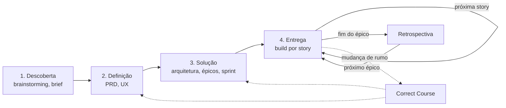

# TCC

Front-end de um sistema de PDV e gestão fiscal (vendas, clientes, estoque e notas fiscais), feito com Angular (componentes standalone, signals) e Tailwind 4. O protótipo original foi gerado no Figma (https://www.figma.com/design/MAlSIV5GZJHlDgVu3WxKof/TCC) em React/Vite e foi traduzido para Angular; o código React fica preservado em `referencia-react/`.

## Como rodar

Execute `npm i` para instalar as dependências.

Execute `npm start` (`ng serve`) para subir o servidor de desenvolvimento em `http://localhost:4200`. Em desenvolvimento o login é mock (`admin@autopecas.com` / `admin123`); para usar a API real, troque `mockAuth` para `false` em `src/environments/environment.development.ts`.

Outros comandos: `npm run build` (build de produção em `dist/tcc`) e `npm test` (testes com Vitest).

A URL da API fica em `src/environments/` (`apiUrl`; padrão `/api` em produção e `http://localhost:3000` em desenvolvimento).

## Estrutura do repositório

| Caminho | O que contém |
|---|---|
| `src/app/pages/` | Telas: Login, Home, PDV, Clientes, Estoque, Painel Fiscal, Cancelamento, Inutilização, Nota de Devolução e Nota de Entrada |
| `src/app/layout/` | Layout, Sidebar e MobileHeader |
| `src/app/cards/` | Cards da Home (Vendas, Estoque e Fiscal) |
| `src/app/core/` | `AuthService` (sessão com signals) e `authGuard` |
| `src/app/services/` | Cliente HTTP (`http.ts`), token em `sessionStorage` e um serviço por recurso |
| `src/app/types/` | Tipos compartilhados (modelo do back) |
| `src/app/app.routes.ts` | Rotas da aplicação |
| `src/environments/` | URL da API e flag do login mock |
| `referencia-react/` | Código React/Vite original (referência da tradução; não faz parte do build) |
| `docs/telas/` | Capturas das telas: Angular e React lado a lado |
| `guidelines/Guidelines.md` | Regras e preferências para agentes de IA |
| `_bmad/` | Instalação do BMAD (módulos `core` e `bmm`; versão em `_bmad/_config/manifest.yaml`). Gerenciada pelo instalador, não edite à mão. Para mudar o comportamento de uma skill, use `/bmad-customize` |
| `_bmad-output/` | Documentos gerados pelo BMAD: planejamento, specs e status das sprints |

## Desenvolvimento com BMAD

O projeto é desenvolvido com o [BMAD Method](https://docs.bmad-method.org/), um fluxo em que agentes de IA conduzem cada etapa e deixam um documento como resultado. Cada etapa é uma *skill* chamada com `/nome-da-skill` no Claude Code. Cada documento alimenta a etapa seguinte, então a ordem importa.

Em dúvida sobre o que fazer agora, rode `/bmad-help`. Ele lê o estado do projeto e recomenda a próxima skill.

### Ciclo recomendado

Resumindo em uma linha: **brainstorming → brief → PRD → UX → arquitetura → épicos e stories → sprint planning → build (spec → aprovação → implementação → revisão) → retrospectiva.**

### Etapas, skills e artefatos

Etapas marcadas como **obrigatória** são exigidas pelo catálogo do BMAD (`_bmad/bmm/module-help.csv`). As demais são opcionais.

| # | Etapa | Skill | Obrigatória | Artefato gerado |
|---|---|---|---|---|
| 1 | Brainstorming | `/bmad-brainstorming` | não | `_bmad-output/brainstorming/` |
| 1 | Brief do produto (ou PRFAQ) | `/bmad-product-brief` (ou `/bmad-prfaq`) | não | `_bmad-output/planning-artifacts/` |
| 2 | PRD | `/bmad-prd` | **sim** | `_bmad-output/planning-artifacts/` |
| 2 | UX (recomendado quando há interface) | `/bmad-ux` | não | `_bmad-output/planning-artifacts/` (`DESIGN.md` e `EXPERIENCE.md`) |
| 3 | Arquitetura | `/bmad-architecture` | **sim** | `_bmad-output/planning-artifacts/` |
| 3 | Épicos e stories | `/bmad-create-epics-and-stories` | **sim** | `_bmad-output/planning-artifacts/` |
| 3 | Sprint planning | `/bmad-sprint-planning` | **sim** | `_bmad-output/implementation-artifacts/sprint-status.yaml` |
| 4 | Build (uma story por vez) | `/bmad-build` | **sim** | spec da story em `_bmad-output/implementation-artifacts/` e o código |
| 4 | Revisão extra, testes e2e, walkthrough | `/bmad-code-review`, `/bmad-qa-generate-e2e-tests`, `/bmad-walkthrough` | não | relatório de revisão, suíte de testes e roteiro de revisão, respectivamente |
| 4 | Retrospectiva do épico | `/bmad-retrospective` | não | `_bmad-output/implementation-artifacts/` |

**Descoberta.** Se a ideia ainda está vaga, use antes `/bmad-forge-idea` para testá-la com perguntas duras. Use `/bmad-deep-recon` para pesquisar mercado, domínio ou tecnologia. Ambos servem para decidir, e o resultado alimenta o brief.

**Definição e solução.** O PRD diz *o quê* e *por quê*. A arquitetura diz *como*, e existe para manter as partes do sistema consistentes entre si. Só depois disso os épicos são quebrados em stories com critérios de aceitação. O sprint planning confere se o planejamento está completo (resultado PASS, CONCERNS ou FAIL) antes de liberar a implementação.

### Ciclo de cada story: `/bmad-build`

O `bmad-build` é o coração da fase de entrega. Ele roda uma story por vez, em cinco passos:

1. **Clarify.** Resolve o estado atual, carrega o contexto do épico e do planejamento e decide a rota.
2. **Plan.** Investiga o código e escreve o **spec** da story em `implementation-artifacts/`. Dúvidas que só uma pessoa pode responder viram perguntas abertas.
3. **Aprovação do spec (checkpoint).** O agente para e espera você aprovar. Veja abaixo.
4. **Implement.** Implementa a partir do spec, testando e verificando os critérios de aceitação.
5. **Review e Present.** Três revisores independentes olham a mudança (Blind Hunter, Edge Case Hunter e Verification Gap). Cada achado é classificado: corrigido, adiado (registrado em `_bmad-output/implementation-artifacts/deferred-work.md`) ou descartado. Ao final o spec vira `done` e um commit local é criado. O agente nunca faz push sozinho.

Mudanças pequenas e sem dúvidas seguem uma rota curta (*oneshot*): o agente implementa e revisa direto, sem parada para aprovação.

O spec percorre o status `draft` → `ready-for-dev` → `in-progress` → `in-review` → `done`.

### Aprovação de spec

No checkpoint, o agente mostra o resumo do spec e oferece três opções:

- **Approve and continue.** Aprova e segue para a implementação na mesma sessão.
- **Approve and stop.** Aprova, deixa o spec como `ready-for-dev` e encerra. Uma sessão nova do `/bmad-build` retoma dali, com o contexto limpo.
- **Review spec.** Discute e ajusta o spec com o agente até você estar satisfeito.

Depois da aprovação, o bloco de intenção do spec fica travado: o agente não o altera, e só você pode renegociá-lo. Por isso o melhor momento para mudar a intenção é antes de aprovar. Vale abrir o arquivo no editor ou pedir uma segunda opinião com `/bmad-advanced-elicitation` ou `/bmad-party-mode`, de preferência em outra sessão.

### Quando o plano muda

- **`/bmad-correct-course`.** Use no meio da sprint quando algo relevante muda. Ele avalia o impacto no PRD, na arquitetura e nos épicos e propõe o que refazer.
- **`/bmad-spec`.** Condensa qualquer material (anotações, transcrição, brief) em um `SPEC.md` curto. Não confunda com o spec de story do `bmad-build`.
- **`/bmad-sprint-planning` (modo status).** Resume o andamento da sprint, os riscos e a próxima ação recomendada, e também valida e repara o arquivo `sprint-status.yaml` quando ele sai de sincronia.
- **`/bmad-project-context`.** Cria ou atualiza o `AGENTS.md` com comandos, convenções e armadilhas conhecidas do repositório, para que os agentes trabalhem melhor nele.

### Agentes com personalidade

Se preferir conversar com um papel específico em vez de chamar a skill direta:

| Agente | Skill | Papel |
|---|---|---|
| Mary | `/bmad-agent-analyst` | Análise de negócio e pesquisa |
| John | `/bmad-agent-pm` | Produto e PRD |
| Sally | `/bmad-agent-ux-designer` | UX e interface |
| Winston | `/bmad-agent-architect` | Arquitetura |
| Amelia | `/bmad-agent-dev` | Implementação |

### Boas práticas

- **Uma sessão por etapa.** Comece uma conversa nova a cada etapa ou story, para não acumular contexto. Os documentos em `_bmad-output/` guardam o estado. No checkpoint do build, escolha **Approve and stop** para retomar em sessão limpa, ou **Approve and continue** quando a story for curta e o contexto ainda estiver leve.
- **Uma story por vez.** Termine o build de uma story antes de começar a próxima.
- **Não pule as etapas obrigatórias.** PRD, arquitetura, épicos e sprint planning evitam retrabalho na implementação.
- **Você aprova, o agente executa.** Leia o spec antes de aprovar. É a última chance de mudar a intenção sem custo.
- **Registre o repositório em Git.** O `bmad-build` usa o commit atual como base da mudança e cria commits locais ao final.
